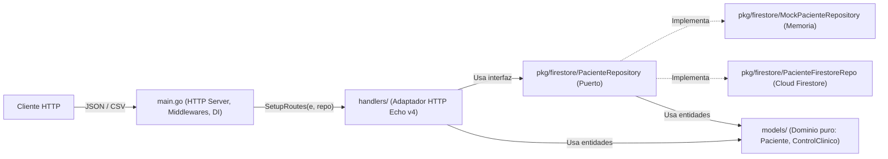

# Arquitectura y Guía de Defensa Técnica — NutriControl API

**NutriControl API** usa una **Arquitectura Hexagonal (Puertos y Adaptadores) minimalista** en **Go 1.26.1** con **Echo v4.16.0** y persistencia intercambiable entre **Cloud Firestore** y un **mock en memoria**, con inyección manual de dependencias y **126 tests automatizados** que corren sin credenciales externas de GCP.

Este documento explica **por qué se eligió esta arquitectura**, **cómo se construyó** y **cómo responder con precisión** a las preguntas técnicas más probables en una revisión, defensa o entrevista.

---

## 1. La respuesta corta (resumen en 30 segundos)

> *"Elegimos una Arquitectura Hexagonal ligera en 3 paquetes (`models/`, `handlers/`, `pkg/firestore/`) porque permite aislar por completo el dominio clínico y los handlers HTTP del almacenamiento real. Gracias al puerto `PacienteRepository`, podemos desarrollar y ejecutar toda la suite de tests en milisegundos con el mock en memoria, probar el cliente real de Firestore contra un servidor gRPC in-process, y pasar a producción en GCP cambiando solo variables de entorno, sin frameworks mágicos ni sobreingeniería."*

---

## 2. Mapa de arquitectura y responsabilidades



| Capa / Paquete | Rol en la arquitectura | Qué conoce | Qué **NO** conoce (frontera) |
|---|---|---|---|
| `models/` (`paciente.go`) | **Dominio puro** (`Paciente`, `ControlClinico`) | Solo librería estándar (`time`) y tags JSON | Echo, HTTP, Firestore, reglas de validación HTTP |
| `pkg/firestore/paciente_repo.go` | **Puerto de salida** (`PacienteRepository`, `ErrControlNoEncontrado`) | `context.Context` y structs de `models/` | Echo, HTTP, SDK de Firestore o detalles de memoria |
| `pkg/firestore/repo.go` | **Adaptador real** (`PacienteFirestoreRepo`) | `cloud.google.com/go/firestore`, `grpc/codes`, `grpc/status`, `models/` | Echo, status codes HTTP, formato CSV o JSON de respuesta |
| `pkg/firestore/mock.go` | **Adaptador mock** (`MockPacienteRepository`) | Slices/mapas en memoria, `sync/atomic`, `models/` | Echo, HTTP, red o GCP |
| `handlers/` (`paciente.go`) | **Adaptador de entrada HTTP + reglas de caso de uso** | Echo v4, `models/`, interfaz `PacienteRepository`, validación clínica, cálculo IMC, CSV | Si el repositorio por debajo es Firestore real o el mock (salvo type assertion explícita en `/health`) |
| `main.go` | **Composición (Wiring) y ciclo de vida HTTP** | Env vars (`PORT`, `NUTRICONTROL_USE_MOCK`, `GCP_PROJECT_ID`), `http.Server`, middlewares Echo, señales OS | Reglas de negocio ni consultas internas |

---

## 3. Por qué se eligió esta arquitectura y este stack

| Decisión | Por qué se construyó así | Alternativa descartada y tradeoff |
|---|---|---|
| **Go 1.26.1 + Echo v4.16.0** | Cumple `docs/constitution.md §1` (minimalismo y control total). Echo aporta router radix rápido, binding JSON y middlewares estándar (`RequestID`, `Logger`, `Recover`) sin ocultar el `*http.Server` subyacente. | Frameworks pesados o con magia por reflexión/decoradores. Tradeoff: más código explícito en `PATCH`, pero cero sorpresas en runtime. |
| **Puertos y Adaptadores en 3 paquetes** | Separa dominio, transporte HTTP y persistencia con una sola interfaz (`PacienteRepository`, 12 métodos). Permite desarrollar offline y ejecutar 126 tests sin cuenta GCP. | Meter Firestore directo en los handlers o crear decenas de carpetas (`usecases/`, `dto/`, `mappers/`). Tradeoff: los handlers orquestan validación + repo directamente para no añadir capas vacías mientras el dominio sea pequeño. |
| **Inyección manual por argumento** (`SetupRoutes(e, repo)`) | En Go, pasar la interfaz como argumento hace explícitas todas las dependencias en compilación sin reflexión ni contenedores DI. | Contenedores DI (`wire`, `fx`, `dig`). Tradeoff: si creciera a decenas de servicios habría que agrupar dependencias en un struct `App`/`Dependencies`. |
| **Firestore frente a SQL** | Aunque `docs/constitution.md §4` contemplaba SQL al inicio (día 3), el proyecto adoptó Cloud Firestore para integrarse con GCP sin levantar un motor SQL local, modelando los controles en la subcolección `pacientes/{id}/controles`. | PostgreSQL/SQLite. Tradeoff: menos potencia en filtros/agregaciones nativas (se resuelven en memoria sobre el padrón activo), pero el puerto `PacienteRepository` permite añadir un adaptador SQL mañana sin tocar `handlers/`. |
| **Soft delete con `DeletedAt *time.Time`** | Preserva trazabilidad clínica y permite listar inactivos (`GET /pacientes/inactivos`) y restaurar (`POST /pacientes/:id/restore`). | Borrado físico (`DELETE` irreversible) o `Activo bool`. Tradeoff: con `bool`, el valor cero en Go (`false`) habría dejado inactivos todos los literales de tests existentes; `*time.Time` con `omitempty` es retrocompatible. |
| **Validación en handlers y modelos puros** | Mantiene `models/` libre de dependencias y convierte los límites clínicos (`edad` 1–120, `peso` >0 y <=500, `porcentaje_grasa` 0–100, `altura` 0.30–2.50 m) en contratos HTTP explícitos (`400 Bad Request`). | Validar dentro de `models` o usar tags `validator`. Tradeoff: reutilizable entre HTTP y batch mediante helpers privados (`validarPaciente`, `validarControlClinico`), aunque acoplado al paquete `handlers` si mañana hubiera otra entrada (CLI/gRPC). |
| **gRPC in-process (`fakeFirestoreServer`)** | Evita dejar `pkg/firestore/repo.go` sin cobertura cuando no hay Docker/Emulator corriendo. Conecta un `*firestore.Client` real contra `firestorepb` en loopback y soporta además `FIRESTORE_EMULATOR_HOST`. | Mockear solo la interfaz sin probar `repo.go`. Tradeoff: mantener `fakeFirestoreServer` en `repo_test.go`, a cambio de verificar serialización real, subcolecciones y `codes.NotFound` (`85.0%` cobertura en `pkg/firestore`). |
| **De SDD a ODD + Engram** | La especificación SDD inicial (`specs/archive/001-persistence-layer/`) duplicaba trabajo y se desincronizaba. ODD prioriza código vivo, ciclo `RED -> GREEN -> refactor`, documentación concisa (`PROJECT_INDEX.md`, `CHANGELOG.md`) y memoria persistente en Engram. | Mantener specs largas previas para cada endpoint pequeño. Tradeoff: requiere disciplina en commits pequeños y actualización documental al cierre de cada hito. |

---

## 4. Cómo evolucionó el proyecto (de v1.0.0 a v1.0.22)

1. **Base hexagonal e independencia de nube (Días 1–5):** módulo Go, Echo v4, separación `models/` + `handlers/`, creación del puerto `PacienteRepository` con `MockPacienteRepository` y `PacienteFirestoreRepo`, y selección por `NUTRICONTROL_USE_MOCK` / `GCP_PROJECT_ID`.
2. **Transición a ODD y CRUD completo de pacientes (v1.0.1–v1.0.9):** IDs autoincrementales en mock (`paciente-<n>`), `GET /pacientes/:id`, búsqueda combinada (`GET /pacientes/search`), ordenamiento dinámico (`sort`/`order`), estadísticas (`stats`, `count`), `GET /health`, `GET /pacientes/edad/:edad`, `PUT` validado, `PATCH` parcial, normalización de nombres y exportación CSV RFC 4180 (`GET /pacientes/export`).
3. **Expansión clínica y analítica (v1.0.10–v1.0.13):** alta masiva atómica en validación (`POST /pacientes/batch`), `Altura` + cálculo OMS de IMC (`/pacientes/imc/:id` y `/pacientes/:id/imc`), reporte analítico (`GET /pacientes/reporte`), soft delete + restauración (`/inactivos`, `/:id/restore`) e historial de controles clínicos en subcolección (`POST/GET /pacientes/:id/controles`).
4. **Ciclo clínico completo, hardening HTTP y CI (v1.0.14–v1.0.19):** `fakeFirestoreServer` gRPC en `repo_test.go`, `/controles/resumen` evolutivo, filtros `?desde=&hasta=` y paginación, exportación CSV de controles (`/controles/export`), CRUD puntual completo de controles (`GET/PUT/PATCH/DELETE .../controles/:controlId` + `/ultimo`), refactorización de `main.go` (timeouts HTTP, middlewares y `graceful shutdown` con `main_test.go`) y pipeline CI en `.github/workflows/ci.yml` (`actions/checkout@v7`, `actions/setup-go@v7`, Node.js 24, `go vet`, `go test -race -cover`, `go build`).
5. **Hardening de entrada, despliegue en contenedor y control de tráfico (v1.0.20–v1.0.22):** validación estricta de tipos JSON en `PatchPaciente`, `BodyLimit`/`CORS` configurables y `strictJSONSerializer`/`bindJSONStrict` (evitando bypass `413` en streaming bajo Go `1.26`), filtrado temporal `?desde=&hasta=` en `/controles/resumen`, `Dockerfile` multi-stage `distroless:nonroot` + `.dockerignore` (runs CI `45597881616` y `45799288074` en verde) y rate limiting opcional por IP en `main.go` (`RATE_LIMIT_RPS`/`RATE_LIMIT_BURST`) con hoja de ruta en `plan.md`.

---

## 5. Cómo responder a posibles preguntas (Guía de defensa)

### Bloque A — Arquitectura y Go idiomático

| Pregunta probable | Cómo explicarlo en 2–3 frases | Evidencia exacta en el repo |
|---|---|---|
| **¿Por qué Arquitectura Hexagonal en una API pequeña? ¿No es demasiada abstracción?** | No hay sobreingeniería: son solo 3 paquetes y 1 interfaz (`PacienteRepository`), sin DTOs redundantes ni contenedores DI. El retorno es tangible desde el día 1: 126 tests corren offline sin credenciales GCP y cambiar el motor de almacenamiento no afecta ni una línea HTTP. | [paciente_repo.go](file:///G:/Proyectos%20OpenCode/ExytControl/NutriControl-API/pkg/firestore/paciente_repo.go), [paciente.go](file:///G:/Proyectos%20OpenCode/ExytControl/NutriControl-API/handlers/paciente.go) |
| **¿Por qué `docs/constitution.md` habla de SQL si el código usa Firestore?** | Es transparencia histórica de la transición SDD → ODD: la constitución se escribió al inicio cuando aún se evaluaba SQL. Al adoptar Cloud Firestore en `pkg/firestore/`, mantener la interfaz `PacienteRepository` dejó abierta la puerta para implementar un adaptador SQL mañana sin reescribir handlers ni tests HTTP. | [constitution.md](file:///G:/Proyectos%20OpenCode/ExytControl/NutriControl-API/docs/constitution.md), [repo.go](file:///G:/Proyectos%20OpenCode/ExytControl/NutriControl-API/pkg/firestore/repo.go) |
| **¿Por qué los handlers reciben `firestore.PacienteRepository` por valor y no como puntero?** | En Go, una interfaz ya es un descriptor `(tipo concreto, valor)`. Un puntero a interfaz (`*firestore.PacienteRepository`) no implementa los métodos de la interfaz y obliga a dereferenciar manualmente; recibirla por valor es el idioma correcto en Go. | [paciente.go](file:///G:/Proyectos%20OpenCode/ExytControl/NutriControl-API/handlers/paciente.go) (`SetupRoutes`) |
| **¿Por qué en `SetupRoutes` cada ruta parametrizada aparece con `:id` y `{id}`, y por qué importa el orden?** | Echo v4 usa `:param` en su árbol radix (mientras `{param}` se trata como literal estático); al migrar de `{id}` a `:id` se conservaron ambas para compatibilidad con tests/clientes antiguos. Además, Echo prioriza segmentos estáticos si se registran antes o en ramas estáticas: por eso `/search`, `/stats`, `/export`, `/inactivos` van antes de `/:id`, y `/controles/resumen`, `/controles/export`, `/controles/ultimo` van antes de `/controles/:controlId` (verificado en fase RED cuando `"ultimo"` fue capturado como `controlId`). | [paciente.go](file:///G:/Proyectos%20OpenCode/ExytControl/NutriControl-API/handlers/paciente.go) (`SetupRoutes`) |

### Bloque B — Persistencia, Firestore y consistencia

| Pregunta probable | Cómo explicarlo en 2–3 frases | Evidencia exacta en el repo |
|---|---|---|
| **¿Cómo aseguran que el mock en memoria y Firestore real se comporten igual?** | Ambos implementan `PacienteRepository` y tienen suites dedicadas (`mock_test.go` y `repo_test.go`) que prueban el mismo contrato: exclusión de `DeletedAt != nil` antes de paginar, orden cronológico ascendente en controles, preservación de `Fecha` cero en `UpdateControl`, aislamiento por paciente y retorno de `ErrControlNoEncontrado`. | [mock.go](file:///G:/Proyectos%20OpenCode/ExytControl/NutriControl-API/pkg/firestore/mock.go), [repo.go](file:///G:/Proyectos%20OpenCode/ExytControl/NutriControl-API/pkg/firestore/repo.go), [repo_test.go](file:///G:/Proyectos%20OpenCode/ExytControl/NutriControl-API/pkg/firestore/repo_test.go) |
| **¿Por qué `SearchPacientes` y `GetAll` en Firestore filtran y ordenan en memoria tras leer documentos?** | Tradeoff consciente por limitaciones nativas de Firestore: no permite filtrar por subcadena case-insensitive (`strings.Contains`) ni combinar múltiples rangos de desigualdad (`edad`, `peso`, `porcentaje_grasa`) sin índices compuestos específicos o un motor externo. Para el volumen inicial de una consulta clínica da comportamiento determinista entre mock y Firestore; si escalara a miles de pacientes, habría que añadir cursores (`StartAfter`) e índices detrás de `PacienteRepository`. | [repo.go](file:///G:/Proyectos%20OpenCode/ExytControl/NutriControl-API/pkg/firestore/repo.go) (`GetAll`), [paciente.go](file:///G:/Proyectos%20OpenCode/ExytControl/NutriControl-API/handlers/paciente.go) (`SearchPacientes`) |
| **¿Por qué `Delete` y `Restore` en `repo.go` usan `docRef.Set` en vez de `Update` parcial?** | `models.Paciente` tiene tags `json:"..."` pero no tags `firestore:"..."`, de modo que el SDK de Firestore serializa campos por el nombre Go (`DeletedAt`) y no por `deleted_at`. Usar `docRef.Set(ctx, p)` sobre el struct leído garantiza coherencia exacta de nombres de campo entre `Create`, `GetByID`, `Update`, `Delete` y `Restore`. | [repo.go](file:///G:/Proyectos%20OpenCode/ExytControl/NutriControl-API/pkg/firestore/repo.go) (`Delete`, `Restore`) |
| **¿Cómo funciona la atomicidad en `POST /pacientes/batch`?** | Aplica validación atómica en dos fases: primero normaliza y valida el 100% del slice (rechazando lote vacío `[]` o cualquier elemento inválido con `400` e índice de fallo, sin tocar la base), y recién después persiste uno a uno. Tradeoff honesto: protege al 100% contra escrituras parciales por errores de datos, pero no usa una transacción multi-documento de Firestore frente a caídas de red a mitad del bucle. | [paciente.go](file:///G:/Proyectos%20OpenCode/ExytControl/NutriControl-API/handlers/paciente.go) (`CreatePacientesBatch`) |
| **¿Por qué `PATCH` deserializa en `map[string]any` y no en el struct?** | Con un struct Go no se puede distinguir si un cliente omitió `porcentaje_grasa` o envió explícitamente `0`. Con `map[string]any` solo se sobreescriben las claves presentes en el JSON, validando cada campo con type assertion seguro (`ok`), `NaN`/`Inf` y enteros estrictos en `edad` tanto en `PatchPaciente` como en `PatchControlPaciente`. | [paciente.go](file:///G:/Proyectos%20OpenCode/ExytControl/NutriControl-API/handlers/paciente.go) (`PatchPaciente`, `PatchControlPaciente`) |
| **¿Cómo distinguen un `404` real de un error `500` de Firestore en controles puntuales?** | Se definió el error centinela `ErrControlNoEncontrado` en `pkg/firestore`. El helper `obtenerControlExistente` traduce únicamente `codes.NotFound` o `!doc.Exists()` a `ErrControlNoEncontrado`, permitiendo a los handlers distinguir `errors.Is(err, firestore.ErrControlNoEncontrado)` (`404`) frente a errores de red/permisos (`500`). | [paciente_repo.go](file:///G:/Proyectos%20OpenCode/ExytControl/NutriControl-API/pkg/firestore/paciente_repo.go), [repo.go](file:///G:/Proyectos%20OpenCode/ExytControl/NutriControl-API/pkg/firestore/repo.go), [paciente.go](file:///G:/Proyectos%20OpenCode/ExytControl/NutriControl-API/handlers/paciente.go) |

### Bloque C — Dominio clínico, HTTP, seguridad y testing

| Pregunta probable | Cómo explicarlo en 2–3 frases | Evidencia exacta en el repo |
|---|---|---|
| **¿Cómo calculan el IMC y qué pasa con pacientes sin altura?** | Se aplica $peso / altura^2$ redondeado a 2 decimales (`math.Round(val*100)/100`) con cortes OMS (`<18.5` Bajo peso, `<25` Normal, `<30` Sobrepeso, `>=30` Obesidad). Como `Altura` es `omitempty`, `/imc` devuelve `400` si falta altura, `/reporte` los agrupa en `sin_datos` (invariante `suma == total`) y en controles `IMC` queda en `0`. | [paciente.go](file:///G:/Proyectos%20OpenCode/ExytControl/NutriControl-API/handlers/paciente.go) (`GetPacienteIMC`, `ReportePacientes`, `calcularIMCControl`) |
| **¿Por qué en `PUT /controles/:controlId` se conserva la fecha previa si se omite, y en `/ultimo` un paciente sin controles da `404`?** | En `PUT`, omitir `fecha` dejaría `time.Time` en `0001-01-01`, corrompiendo el orden cronológico del historial al corregir solo peso o notas; conservar `existing.Fecha` cuando `IsZero()` protege la línea temporal. En `/ultimo`, al representar un recurso puntual `ControlClinico`, devolver `404` evita emitir un struct vacío con fecha cero como si fuera un control real. | [mock.go](file:///G:/Proyectos%20OpenCode/ExytControl/NutriControl-API/pkg/firestore/mock.go), [repo.go](file:///G:/Proyectos%20OpenCode/ExytControl/NutriControl-API/pkg/firestore/repo.go), [paciente.go](file:///G:/Proyectos%20OpenCode/ExytControl/NutriControl-API/handlers/paciente.go) (`GetUltimoControlPaciente`) |
| **¿Qué hardening tiene el servidor HTTP, el contenedor y el exportador CSV?** | `main.go` separa `newEchoWithConfig` (`RequestID` → `Logger` → `Recover` → `CORSWithConfig` opcional con `AllowCredentials: false` → `RateLimiterWithConfig` opcional con `RATE_LIMIT_RPS`/`RATE_LIMIT_BURST` eximiendo `OPTIONS` y `/health` → `BodyLimit` validado con `bytes.Parse`), `strictJSONSerializer`/`bindJSONStrict` (lectura completa previa para no perder `413` en streaming), `newServerWithConfig` (timeouts `5s`/`15s`/`15s`/`60s`) y `serve` (`signal.NotifyContext` + `Shutdown` en `10s` drenando `errCh`). El `Dockerfile` multi-stage compila binario estático (`CGO_ENABLED=0`) sobre `gcr.io/distroless/static-debian12:nonroot` (sin shell, con CA certs para Firestore y `ENTRYPOINT` exec para recibir `SIGTERM` directo). En CSV, `encoding/csv` escapa según RFC 4180 y `ExportControlesPacienteCSV` fija `filename="controles.csv"` estático para evitar inyección de cabeceras vía `:id`. | [main.go](file:///G:/Proyectos%20OpenCode/ExytControl/NutriControl-API/main.go), [Dockerfile](file:///G:/Proyectos%20OpenCode/ExytControl/NutriControl-API/Dockerfile), [paciente.go](file:///G:/Proyectos%20OpenCode/ExytControl/NutriControl-API/handlers/paciente.go) (`escribirCSV`, `bindJSONStrict`) |
| **¿Por qué `handlers/paciente_test.go` usa `reflect` + `unsafe` en `setParam`?** | En los tests unitarios iniciales que llamaban al handler directo sin router, `c.Param("id")` venía vacío porque Echo v4 guarda `pnames`/`pvalues` en campos no exportados. Se usó `setParam` para mantener esos tests unitarios antiguos sin modificarlos, mientras que todos los endpoints nuevos (`batch`, `imc`, `reporte`, `controles/*`, `export`) prueban el flujo HTTP real completo con `e.ServeHTTP`. | [paciente_test.go](file:///G:/Proyectos%20OpenCode/ExytControl/NutriControl-API/handlers/paciente_test.go) (`setParam`) |
| **¿Cómo validan race conditions si en Windows no hay `gcc` para `-race`?** | El workflow `.github/workflows/ci.yml` corre en `ubuntu-latest` (`actions/checkout@v7` y `actions/setup-go@v7`, Node.js 24) ejecutando `go vet ./...`, `go test -race -cover -count=1 ./...` y `go build ./...` (confirmado en verde sin avisos Node 20 en runs `45597881616` y `45799288074`). Además, `fakeFirestoreServer` sincroniza su estado con `sync.Mutex` y `TestServeGracefulShutdown` se validó en 50 iteraciones consecutivas. | [ci.yml](file:///G:/Proyectos%20OpenCode/ExytControl/NutriControl-API/.github/workflows/ci.yml), [repo_test.go](file:///G:/Proyectos%20OpenCode/ExytControl/NutriControl-API/pkg/firestore/repo_test.go) |

---

## 6. Deuda técnica conocida (qué responder si te preguntan "¿qué mejorarías?")

Reconocer estas limitaciones reales demuestra dominio del código:

1. **Autenticación y límites distribuidos:** la API ya cuenta con `BodyLimit`, `CORS` desactivado por defecto, `RateLimiterMemoryStore` opcional por IP/instancia (`RATE_LIMIT_RPS`/`RATE_LIMIT_BURST`, que asume proxy confiable en `X-Forwarded-For` vía `c.RealIP()` y omite `Retry-After`) y timeouts HTTP, pero aún no incluye autenticación/autorización (JWT/`API_KEY`) ni almacén distribuido (Redis/Cloud Armor) entre réplicas.
2. **Escalabilidad de consultas en Firestore:** `GetAll` y `SearchPacientes` leen documentos activos y filtran/ordenan en memoria; para grandes volúmenes habría que añadir cursores (`StartAfter`), límites en consulta e índices.
3. **Concurrencia en `MockPacienteRepository`:** los contadores usan `sync/atomic`, pero `store` y `controles` no tienen `sync.RWMutex` porque está pensado para tests secuenciales/desarrollo local (no para concurrencia en producción).

---

## 7. Checklist rápido para enseñar el proyecto en vivo

```bash
# 1. Arrancar en modo mock (sin credenciales GCP)
NUTRICONTROL_USE_MOCK=true go run ./...

# 2. Verificar calidad, cobertura y compilación
go vet ./...
go test -cover -count=1 ./...
go build ./...

# 3. Revisar estado del CI en GitHub (con GitHub CLI)
gh run list --limit 5
```
